# Plano de engenharia — FluxoFiscal, TG II

**Autor:** Ronaldo Chiavegatti Sampaio Corrêa
**Data:** 22 de agosto de 2026
**Linha de base:** commit `551bf6b` (protótipo importado)

---

## Sumário

| Documento | Conteúdo |
| --- | --- |
| Este arquivo | Diagnóstico, decisões, roadmap, riscos, medição |
| [`BACKLOG.md`](BACKLOG.md) | 56 histórias de usuário com critérios de aceite |
| [`arquitetura/README.md`](arquitetura/README.md) | Arquitetura alvo, contextos delimitados, fluxos |
| [`dashboard-v2.md`](dashboard-v2.md) | Dashboard, motor de ritmo, controles de gestão |
| [`contexto-do-agente.md`](contexto-do-agente.md) | Janela, orçamento, memória, RAG, avaliação |
| [`observabilidade/README.md`](observabilidade/README.md) | Telemetria, painéis, alertas |
| [`observabilidade/slos.yaml`](observabilidade/slos.yaml) | SLOs formais |
| [`feature-flags.yaml`](feature-flags.yaml) | Inventário de flags |
| [`versionamento.md`](versionamento.md) | Ramos, commits, tags, rastreabilidade |
| [`adr/`](adr/README.md) | 14 decisões arquiteturais registradas |
| [`IMPACTO-ARTIGO.md`](IMPACTO-ARTIGO.md) | O que muda em cada seção do artigo |

---

## 1. Onde estamos

O protótipo funciona. Seis serviços FastAPI atrás de um gateway NGINX, RAG real
com pgvector, extração multimodal via Gemini com contingência por expressões
regulares, cálculo do limite anual e um frontend React integrado ponta a ponta.
Como prova de conceito, ele cumpriu o que se propôs.

O que falta não é funcionalidade — é **engenharia**. E há uma distância entre o
que o artigo afirma e o que o código faz.

### 1.1 O que o artigo promete e o código não entrega

| Afirmação do artigo | Realidade no código | Como resolvemos |
| --- | --- | --- |
| "Tailwind CSS para estilização" | 248 linhas de CSS manual e estilos embutidos | Migrar ([ADR-0010](adr/0010-tailwind-e-recharts-no-frontend.md)) |
| "MongoDB para metadados e logs" | Não existe | Implementar ([ADR-0005](adr/0005-mongodb-para-metadados-e-auditoria.md)) |
| "Celery e Redis para OCR e LLM" | Tudo síncrono | Implementar ([ADR-0003](adr/0003-processamento-assincrono-redis-celery.md)) |
| "MinIO como armazenamento" | Volume Docker local | Implementar ([ADR-0004](adr/0004-minio-como-object-storage.md)) |
| "Filas de mensagens entre serviços" | Chamadas REST diretas | Implementar ([ADR-0006](adr/0006-eventos-com-redis-streams-e-outbox.md)) |
| "Testes cobrindo os principais fluxos" | Zero teste automatizado | Implementar ([ADR-0013](adr/0013-piramide-de-testes-e-portoes.md)) |
| "Faturamento por consumo de tokens" | Tabela fixa de 15 e 5 tokens | Medir de verdade ([ADR-0012](adr/0012-medicao-real-de-tokens-do-llm.md)) |
| "Monitoramento via Prometheus e Grafana" | Declarado como etapa futura | Implementar ([ADR-0007](adr/0007-observabilidade-otel-grafana.md)) |

Cada linha dessa tabela é uma afirmação que hoje não se sustenta sob verificação.
Ao final deste plano, todas se sustentam.

### 1.2 Problemas que o artigo ainda não registra

| Problema | Evidência no código | Consequência |
| --- | --- | --- |
| Chave de API real versionada | `.env` com `GEMINI_API_KEY` preenchida, em pasta vinda de `.zip` | Risco de uso indevido por terceiros |
| Não dá para lançar sem documento | `POST /limits/transactions` existe, mas não está na interface | Venda em dinheiro não entra no sistema |
| Limite proporcional ignorado | `MEI_ANNUAL_LIMIT = 81000.00`, constante | MEI aberto em julho é informado de que está seguro quando pode ter estourado |
| Falha de indexação silenciosa | `except httpx.RequestError: pass` | Documento confirmado que nunca chega ao RAG |
| Cobrança pelo cliente | Frontend chama `/billing/tokens/consume` | Consumir sem pagar é trivial |
| Regra fiscal triplicada | `get_summary`, `DashboardPage.tsx`, prompt do agente | Divergência é questão de tempo |
| RAG sem limiar | `order_by(...).limit(3)` sempre devolve 3 | Pergunta fora do domínio recebe trecho irrelevante como fonte |
| Reindexação duplica | `index_document` sempre insere | Reenvio enviesa a recuperação |
| Zero observabilidade | `echo=True` no auth é o "log" | Nenhuma pergunta operacional tem resposta |

---

## 2. Decisões desta fase

| Tema | Decisão | Registro |
| --- | --- | --- |
| Repositório | Monorepo privado no GitHub | [ADR-0001](adr/0001-monorepo-privado-no-github.md) |
| Ramos e commits | Trunk-based, Conventional Commits, SemVer | [ADR-0002](adr/0002-trunk-based-e-conventional-commits.md) |
| Assincronia | Redis + Celery | [ADR-0003](adr/0003-processamento-assincrono-redis-celery.md) |
| Arquivos | MinIO com URL pré-assinada | [ADR-0004](adr/0004-minio-como-object-storage.md) |
| Metadados | MongoDB, documentos e auditoria | [ADR-0005](adr/0005-mongodb-para-metadados-e-auditoria.md) |
| Integração | Redis Streams + Outbox | [ADR-0006](adr/0006-eventos-com-redis-streams-e-outbox.md) |
| Observabilidade | OpenTelemetry + pilha Grafana + SLOs + k6 | [ADR-0007](adr/0007-observabilidade-otel-grafana.md) |
| Feature flags | Unleash auto-hospedado | [ADR-0008](adr/0008-unleash-para-feature-flags.md) |
| Análise | Insights Service, modelo de leitura | [ADR-0009](adr/0009-servico-de-insights-com-cqrs.md) |
| Frontend | Tailwind + Recharts | [ADR-0010](adr/0010-tailwind-e-recharts-no-frontend.md) |
| Autenticação | Mantida simplificada, com salvaguardas | [ADR-0011](adr/0011-manter-autenticacao-simplificada.md) |
| Faturamento | Consumo real de tokens, débito no servidor | [ADR-0012](adr/0012-medicao-real-de-tokens-do-llm.md) |
| Testes | Cinco níveis, portões progressivos | [ADR-0013](adr/0013-piramide-de-testes-e-portoes.md) |
| Entrega | Contínua até o GHCR, deploy via Compose | [ADR-0014](adr/0014-entrega-continua-ate-o-ghcr.md) |
| Notificação | In-app apenas | — |
| Contexto | Contextos delimitados **e** contexto do agente | [`contexto-do-agente.md`](contexto-do-agente.md) |

---

## 3. Roadmap por ondas de valor

Sem prazo fixo, o roadmap se organiza por **incrementos demonstráveis**, não por
datas. Cada onda tem um critério de saída objetivo e produz evidência utilizável
no artigo. Uma onda só termina quando o critério de saída é verificável — não
quando o tempo acabou.

```mermaid
gantt
    title Ondas de valor
    dateFormat X
    axisFormat %s
    section Fundação
    Onda 0 · Engenharia base        :done, o0, 0, 47
    section Operação
    Onda 1 · Observabilidade        :o1, after o0, 36
    Onda 2 · Feature flags          :o2, after o1, 13
    section Arquitetura
    Onda 3 · Assíncrono e eventos   :o3, after o2, 70
    section Produto
    Onda 4 · Dashboard e ritmo      :o4, after o3, 55
    Onda 5 · Controles de gestão    :o5, after o4, 44
    section Inteligência
    Onda 6 · Contexto do agente     :o6, after o5, 56
    section Fechamento
    Onda 7 · Privacidade e evidência :o7, after o6, 18
```

### Onda 0 — Fundação de engenharia · 47 pontos

**Por que primeiro:** nenhuma das ondas seguintes é segura sem teste, sem
histórico e sem pipeline. Refatorar o Documents para assíncrono sem uma suíte que
prove que o cálculo do limite continua correto é aposta, não engenharia.

**Histórias:** US-01 a US-08

**Critério de saída**
- Repositório no GitHub, `main` protegida, zero segredo no histórico
- Chave do Gemini revogada e rotacionada
- `dominio/` extraído, com 95% de cobertura e 80% de mutantes mortos
- CI verde em menos de 10 minutos, subindo o Compose de verdade
- Imagens publicadas no GHCR a cada commit da `main`
- Coleta DORA rodando

**Evidência para o artigo:** histórico de commits como prova do processo
incremental; primeiros dados DORA; metodologia de testes.

> **Atualização de 12/09/2026 (ADR-0020):** os quatro critérios acima
> estiveram de pé até a Onda 4. GitHub Actions foi desligado por cobrança da
> conta — CI, publicação no GHCR e coleta DORA pausaram nessa data. Os
> portões passam a rodar localmente, com o resultado documentado no commit;
> ver a nota em §5.1.

---

### Onda 1 — Observabilidade · 36 pontos

**Por que agora:** é preciso medir o sistema **antes** de mudá-lo. Sem a linha de
base de 4,5 s no upload e 8,54 s no chat medida com a instrumentação atual, não
há como afirmar depois que a arquitetura assíncrona melhorou nada.

**Histórias:** US-09 a US-14

**Critério de saída**
- Logs em JSON com identificador de correlação atravessando os serviços
- RED e 12 métricas de negócio ativas
- Rastreamento distribuído, com salto painel → rastro → log
- SLOs declarados, com alertas em janelas múltiplas
- k6 rodando e identificando o ponto de saturação
- **Linha de base registrada** de latência e acurácia

**Evidência:** capturas dos painéis; tabela de linha de base para comparação
posterior; primeira medida real de escalabilidade.

---

### Onda 2 — Feature flags · 13 pontos

**Por que agora:** as ondas 3 a 6 têm mudanças arriscadas. Sem flags, cada uma
precisaria de ramo longo — o oposto do que o [ADR-0002](adr/0002-trunk-based-e-conventional-commits.md) estabeleceu.

**Histórias:** US-15 e US-16. **US-17 adiada** — o modo de avaliação demonstra
os 6 níveis do motor de ritmo (Onda 4) sobre cenários do Insights (Onda 3), e
nenhum dos dois existe ainda; entra junto com o motor de ritmo. Ver a nota em
[`BACKLOG.md`](BACKLOG.md).

**Critério de saída**
- Unleash em execução, SDKs integrados no backend e no frontend
- Indisponibilidade do Unleash não derruba nada
- Auditoria de inventário reprovando flag não declarada
- ~~Modo de avaliação demonstrando os 6 níveis de alerta em 2 minutos~~ (US-17, adiada)

**Evidência:** interface do Unleash com liberação percentual; auditoria de flags
já rodando na CI (pegou uso indevido de flag no PR da US-15).

---

### Onda 3 — Assíncrono, persistência e eventos · 70 pontos

**A onda mais pesada.** É onde o código passa a fazer o que o artigo diz.

**Histórias:** US-18 a US-23, US-46, US-47

**Critério de saída**
- Upload responde em menos de 500 ms, contra 6,00 s da linha de base
- Arquivos no MinIO, criptografados, com URL pré-assinada
- Documentos persistidos, com deduplicação por hash funcionando
- Eventos publicados por Outbox; nenhum evento perdido em teste de caos
- Insights servindo projeções com frescor abaixo de 2 s
- Camadas anticorrupção implementadas e contratos verificados na CI

**Evidência:** comparação antes e depois de latência com o mesmo instrumento —
o resultado quantitativo mais forte que o artigo pode apresentar sobre
arquitetura.

**Sequência interna:** MinIO e Mongo primeiro (persistência antes de assincronia,
para que a tarefa tenha onde gravar) → Celery → Outbox e eventos → Insights.

---

### Onda 4 — Dashboard e motor de ritmo · 55 pontos

**O que o usuário pediu.** As ondas anteriores existem para que esta seja
possível e mensurável.

**Histórias:** US-24 a US-29c

**Critério de saída**
- Tailwind aplicado, sem hexadecimal literal fora do tema
- Gauge, painel de ritmo e tiles com minigráficos
- Gráfico de corrida contra o limite, com cone de projeção e anotação de cruzamento
- Mês a mês com meta; origem do faturamento com aviso de concentração
- Motor de ritmo com as guardas contra projeção enganosa
- 6 tipos de alerta, com silêncio, escalada e teto diário
- Centro de notificações in-app
- Limite proporcional aplicado

**Evidência:** capturas do dashboard; comparação entre variantes com liberação
percentual; questionário SUS com 8 a 10 MEIs — que converte a avaliação de
usabilidade do artigo de qualitativa em quantitativa.

---

### Onda 5 — Controles de gestão · 44 pontos

**Histórias:** US-30 a US-38b

**Critério de saída**
- Lançamento manual em menos de 20 segundos
- Simulador de faturamento operando
- Metas mensais, categorias, perfil do MEI
- Edição em massa com desfazer; edição em linha
- Exportação CSV e XLSX; comparativo anual; filtros e busca

**Evidência:** taxa de uso do simulador; volume de lançamentos manuais — que
hoje é necessariamente zero, porque a funcionalidade não existe.

---

### Onda 6 — Contexto do agente · 56 pontos

**Histórias:** US-39 a US-45, US-48, US-48b

**Critério de saída**
- Conversas persistidas, com memória de curto, médio e longo prazo
- Montagem em camadas com orçamento de tokens, contado e não estimado
- Busca híbrida com fusão RRF e segmentação semântica
- Limiar de similaridade, com abstenção correta acima de 90%
- Fontes citadas e verificáveis
- Cobrança por consumo real, debitada no servidor
- Glossário e mapa de contexto documentados

**Evidência:** conjunto de referência ampliado de 5 para 30 perguntas, com
métricas por técnica. Como cada técnica tem sua própria flag, é possível afirmar
**qual** delas produziu **qual** ganho — em vez de medir só o pacote.

---

### Onda 7 — Privacidade e fechamento · 18 pontos

**Histórias:** US-49 a US-52

**Critério de saída**
- Retenção e expurgo automáticos
- Exclusão a pedido do titular, com comprovante
- Criptografia em repouso e mascaramento em toda a telemetria
- Limite de taxa no gateway

**Evidência:** as três pendências de LGPD que o artigo declara passam de
"trabalho futuro" para "implementado".

---

## 4. Riscos

| Risco | Prob. | Impacto | Mitigação |
| --- | --- | --- | --- |
| Escopo grande demais para o tempo real disponível | Alta | Alto | Ondas independentes e demonstráveis. Parar após a Onda 4 já entrega um trabalho completo e coerente |
| Chave do Gemini já vazada e em uso por terceiros | Média | Alto | US-02 é a primeira tarefa. Revogar antes de qualquer coisa |
| Cota da API estourar durante testes | Média | Médio | Testes rodam sem chave, exercitando o modo demonstração; flag `ops-desligar-gemini` como corte de emergência |
| Compose ficar pesado demais para a máquina de desenvolvimento | Média | Médio | Observabilidade em perfil separado; Compose mínimo documentado |
| Migração para MinIO perder arquivo | Baixa | Alto | Leitura com contingência para o volume local durante a transição; migração idempotente; nada é apagado antes da conferência |
| Consistência eventual confundir o usuário | Média | Baixo | Frescor exibido na tela; totais críticos continuam lidos direto do Limits |
| Excesso de feature flags virar débito | Média | Médio | Data de remoção obrigatória, auditada semanalmente pela CI |
| Alertas de ritmo virarem ruído | Média | Alto | Guardas contra projeção com dado insuficiente; silêncio; escalada; teto diário; taxa de dispensa monitorada |
| Refatoração quebrar a regra fiscal | Média | Alto | Onda 0 antes de tudo; teste de mutação no núcleo fiscal |

**O risco mais provável é o primeiro.** O plano tem 339 pontos, e é deliberado
que ele seja maior do que provavelmente caberá no tempo. Por isso as ondas são
ordenadas por dependência real e cada uma termina em algo demonstrável: parar
após qualquer onda deixa um sistema coerente, não pela metade.

---

## 5. Mensuramento

Quatro famílias de medida, cada uma respondendo a uma pergunta diferente.

### 5.1 Processo — estamos entregando bem?

> **Série com corte em 12/09/2026** (ADR-0020): GitHub Actions foi desligado
> por cobrança da conta, e as quatro métricas via `dora.yml` — assim como a
> duração da CI — pararam de ser coletadas automaticamente nessa data. Os
> números até lá continuam válidos como amostra do período com CI ativa; o
> artigo precisa registrar o corte, não tratar a série como contínua até a
> defesa. Cobertura e mutantes mortos continuam medidos — agora localmente,
> a cada história, sem mudar a fonte.

| Métrica | Fonte | Alvo |
| --- | --- | --- |
| Frequência de implantação | `dora.yml` (até 12/09/2026) | mais de 3 por semana |
| Lead time para mudanças | `dora.yml` (até 12/09/2026) | abaixo de 24 h |
| Taxa de falha de mudanças | `dora.yml` (até 12/09/2026) | abaixo de 15% |
| Tempo para restaurar | `dora.yml` (até 12/09/2026) | abaixo de 1 h |
| Duração da CI | GitHub Actions (até 12/09/2026) | abaixo de 10 min |
| Cobertura de testes | pytest-cov, Vitest | 95% domínio, 80% serviço |
| Mutantes mortos | mutmut | acima de 80% no núcleo fiscal |

### 5.2 Sistema — está funcionando bem?

Todos os SLOs de [`slos.yaml`](observabilidade/slos.yaml): disponibilidade,
latência, frescor, correção e custo, com orçamento de erro monitorado.

### 5.3 Produto — está entregando valor?

| Métrica | Alvo |
| --- | --- |
| Acurácia da extração, por campo | acima de 90%; acima de 95% no valor |
| Acerto do RAG na primeira posição | acima de 90% |
| Abstenção correta | acima de 90% |
| Precisão numérica do agente | 100% |
| Tempo até a primeira ação no dashboard | queda de 30% |
| Uso do simulador | acima de 25% das sessões |
| Alertas dispensados sem ação | abaixo de 40% |
| Pontuação SUS | acima de 75 |

### 5.4 Custo — é viável?

| Métrica | Alvo |
| --- | --- |
| Custo de LLM por dia | abaixo de R$ 5,00 |
| Custo por documento processado | abaixo de R$ 0,05 |
| Custo por conversa | medido, para sustentar a discussão de viabilidade |

**Tudo era coletado automaticamente** até 12/09/2026 (ADR-0020). O pipeline
noturno gerava as tabelas em Markdown prontas para o artigo, com data e
identificação do commit — nenhum número da seção de resultados precisava ser
transcrito à mão, o que elimina a categoria de erro mais comum em trabalho
acadêmico com dados experimentais. As famílias que não dependem de
`dora.yml`/Actions (produto, custo, e processo medido localmente a cada
história) continuam nesse regime; a série de processo via CI tem o corte
registrado em §5.1.

---

## 6. Próximos passos

**Ordem sugerida a partir daqui:**

1. **Revogar a chave do Gemini** (US-02). É a única tarefa realmente urgente.
2. Criar o repositório no GitHub e empurrar o histórico (US-01).
3. Transformar as 56 histórias em issues, organizadas em um GitHub Project.
4. Extrair o núcleo de domínio fiscal (US-03) — é a base de tudo o mais.
5. Escrever a suíte de testes (US-04, US-05).
6. Ligar a CI (US-06).

Do passo 6 em diante, o roadmap por ondas assume.
