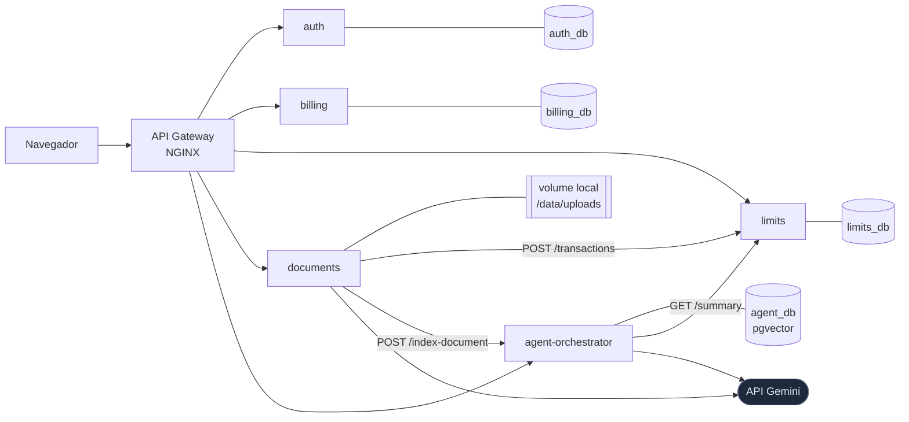
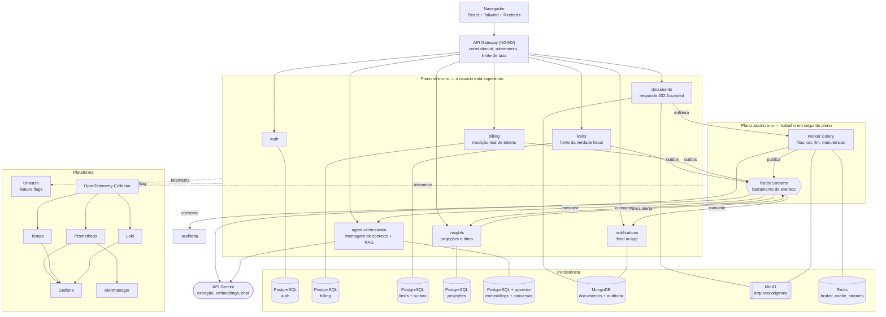
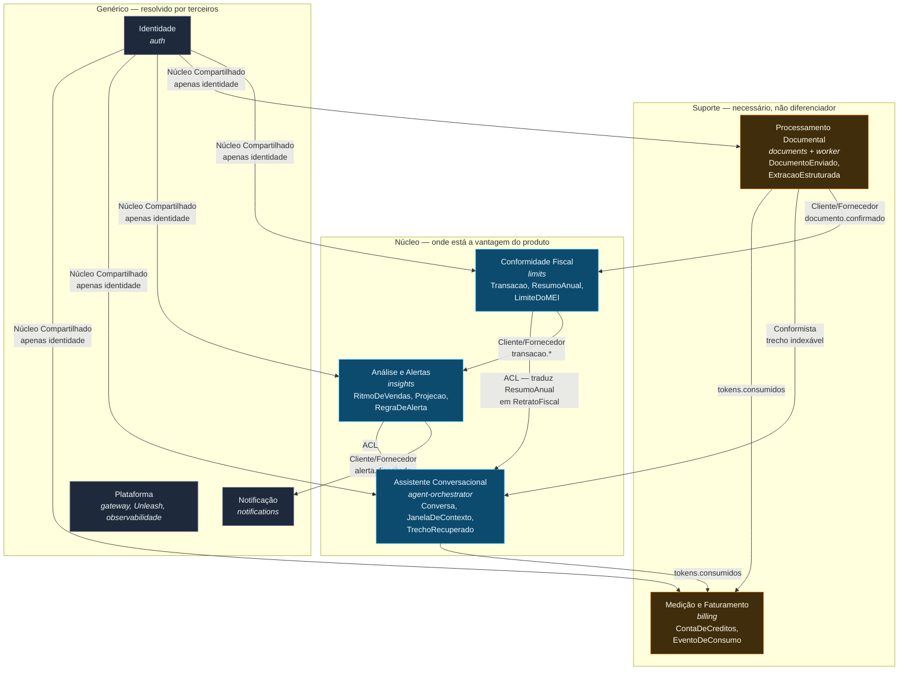
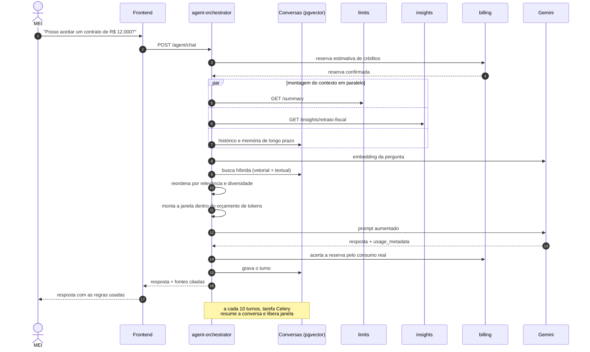

# Arquitetura alvo

Este documento descreve para onde a plataforma vai. O estado atual está
descrito na seção "De onde partimos"; as decisões que produziram o desenho alvo
estão nos [ADRs](../adr/README.md).

---

## 1. De onde partimos

Seis serviços, comunicação exclusivamente síncrona, cada chamada conhecendo o
endereço do destino.



**O que dói neste desenho**

| Problema | Onde aparece | Consequência |
| --- | --- | --- |
| OCR e LLM dentro da requisição HTTP | `documents/app/main.py` | 4,5 s por upload, worker bloqueado |
| Falha silenciosa na indexação | `except httpx.RequestError: pass` | Documento confirmado que nunca chega ao RAG |
| Arquivo em volume local | `UPLOAD_DIR = Path("/data/uploads")` | Serviço não replica, sem criptografia, sem retenção |
| Nenhum metadado persistido | Documents não tem banco | Reprocessar custa API de novo; lista vive no `localStorage` |
| Zero observabilidade | Todos | Nenhuma pergunta operacional tem resposta |
| Cálculo analítico no navegador | `DashboardPage.tsx` | Regra fiscal espalhada pela camada de apresentação |

---

## 2. Para onde vamos



### O que muda, em uma frase cada

| Mudança | ADR |
| --- | --- |
| Upload responde em milissegundos; OCR e LLM vão para fila Celery | [0003](../adr/0003-processamento-assincrono-redis-celery.md) |
| Arquivos saem do volume local e vão para o MinIO, com URL pré-assinada | [0004](../adr/0004-minio-como-object-storage.md) |
| Documentos e auditoria passam a ser persistidos no MongoDB | [0005](../adr/0005-mongodb-para-metadados-e-auditoria.md) |
| Serviços passam a conversar por eventos, com Outbox garantindo a publicação | [0006](../adr/0006-eventos-com-redis-streams-e-outbox.md) |
| Toda requisição vira métrica, rastro e log correlacionados | [0007](../adr/0007-observabilidade-otel-grafana.md) |
| Mudança arriscada nasce atrás de flag reversível em um clique | [0008](../adr/0008-unleash-para-feature-flags.md) |
| Cálculo analítico sai do navegador e vira modelo de leitura | [0009](../adr/0009-servico-de-insights-com-cqrs.md) |
| Cobrança passa a refletir consumo real de tokens do modelo | [0012](../adr/0012-medicao-real-de-tokens-do-llm.md) |

---

## 3. Contextos delimitados e mapa de contexto

Antes de desenhar serviços, é preciso desenhar fronteiras de significado. A
palavra "documento" quer dizer coisas diferentes em partes diferentes do
sistema, e é exatamente por isso que cada contexto tem o seu próprio modelo.



### Linguagem ubíqua, por contexto

O mesmo termo muda de sentido conforme a fronteira. Confundir esses sentidos é
a origem mais comum de bug em sistema fiscal.

| Termo | Processamento Documental | Conformidade Fiscal | Análise e Alertas |
| --- | --- | --- | --- |
| **Documento** | Arquivo enviado, com OCR, extração e estados | Não existe — só a `origem` da transação | Não existe |
| **Valor** | Número extraído, com grau de confiança | Valor confirmado, imutável após revisão | Ponto de uma série temporal |
| **Venda** | Sugestão derivada do confronto de CNPJ | Fato: `tx_type = venda`, conta para o teto | Componente do ritmo |
| **Confiança** | Qualidade da extração (0 a 1) | Não existe — o dado confirmado é certo | Não existe |
| **Limite** | Não existe | R$ 81.000,00, ou proporcional ao mês de abertura | Referência das projeções |

**Regra de fronteira:** o grau de confiança da extração **nunca** atravessa para
a Conformidade Fiscal. Uma transação registrada é um fato confirmado por um
humano, não uma estimativa. É a revisão manual que transforma incerteza em fato,
e é essa fronteira que torna o dado fiscal defensável.

### Camadas anticorrupção

Três traduções explícitas impedem que um modelo externo contamine o domínio:

1. **Gemini → Documento.** A resposta do modelo é texto que se parece com JSON.
   A tradução valida tipos, normaliza CNPJ, rejeita valor não positivo e data
   fora do formato. É o que `sanitize_gemini_result` já faz hoje, e que passa a
   ser uma camada nomeada e testada.
2. **Limits → Assistente.** O `ResumoAnual` do Limits vira um `RetratoFiscal`
   com a linguagem do agente. Mudar o formato do resumo não deve exigir
   reescrever prompt.
3. **Documento → Trecho indexável.** O que entra no índice vetorial é texto
   limpo e segmentado, não a estrutura do documento.

---

## 4. Fluxo de upload, do envio à projeção

```mermaid
sequenceDiagram
    autonumber
    actor MEI
    participant FE as Frontend
    participant GW as Gateway
    participant DO as documents
    participant MN as MinIO
    participant MG as MongoDB
    participant WK as worker
    participant GE as Gemini
    participant BUS as Redis Streams
    participant LI as limits
    participant IN as insights
    participant NO as notifications

    MEI->>FE: seleciona a nota fiscal
    FE->>GW: POST /documents/upload
    GW->>DO: encaminha com correlation-id
    DO->>DO: calcula hash SHA-256
    alt hash já existe
        DO-->>FE: 200 com o documento anterior
        Note over DO,FE: deduplicação evita<br/>cobrar a API duas vezes
    else documento novo
        DO->>MN: grava o arquivo original
        DO->>MG: cria registro, estado "recebido"
        DO->>WK: enfileira processar_documento (fila ocr)
        DO-->>FE: 202 Accepted + id + URL de acompanhamento
        FE-->>MEI: "Processando..." com barra de progresso
        WK->>DO: POST /_interno/processar/{id}
        Note over WK,DO: o worker orquestra;<br/>o pipeline fica no Documents<br/>(ADR-0016)
        DO->>MN: lê o arquivo original
        DO->>DO: Tesseract + extração multimodal (Gemini)
        DO->>MG: estado "extraido", campos, confiança
        DO-->>WK: 200 (ou 503 -> retry com recuo, 3x -> estado "erro")
        WK->>BUS: publica documento.extraido
        FE->>GW: GET /documents/documentos/{id} (polling)
        FE-->>MEI: tela de revisão preenchida (ou falha + "tentar de novo")
    end

    MEI->>FE: corrige o valor e confirma como venda
    FE->>GW: POST /documents/confirm
    GW->>DO: encaminha
    DO->>MG: estado "confirmado" + revisão humana
    DO->>BUS: outbox publica documento.confirmado

    par consumidores reagem em paralelo
        BUS->>LI: registra a transação
        LI->>BUS: outbox publica transacao.criada
    and
        BUS->>IN: atualiza projeções e ritmo
        IN->>IN: avalia as regras de alerta
        IN->>BUS: publica alerta.disparado
        BUS->>NO: grava no feed in-app
    end

    NO-->>FE: badge de notificação
    FE-->>MEI: "No ritmo atual, você atinge o teto em 12/nov"
```

O ponto central do desenho: entre o passo 8 (`202 Accepted`) e o passo 20 o
usuário nunca fica bloqueado, e nenhuma falha de consumidor derruba a
confirmação dele.

---

## 5. Fluxo do chat, com contexto montado



---

## 6. Portas de rede

| Serviço | Porta interna | Exposta | Observação |
| --- | --- | --- | --- |
| api-gateway | 80 | 8000 | única entrada da aplicação |
| frontend | 5173 | 3000 | Vite em desenvolvimento |
| auth, billing, limits, documents, agent, insights, notifications | 8000 | — | só pela rede interna |
| worker | — | — | sem porta, consome fila |
| PostgreSQL (5 instâncias) | 5432 | — | uma por serviço |
| MongoDB | 27017 | — | |
| Redis | 6379 | — | broker, cache e streams |
| MinIO | 9000 / 9001 | 9001 | console administrativo |
| Unleash | 4242 | 4242 | interface de flags |
| Grafana | 3000 | 3001 | painéis |
| Prometheus | 9090 | 9090 | perfil de observabilidade |
| Tempo | 3200 | — | |
| Loki | 3100 | — | |
| Alertmanager | 9093 | 9093 | |
| OTel Collector | 4317 / 4318 | — | gRPC e HTTP |

---

## 7. Perfis do Compose

```bash
# só a aplicação
docker compose up -d

# aplicação + pilha de observabilidade
docker compose --profile observability up -d

# demonstração, com imagens publicadas na CI
docker compose -f docker-compose.release.yml pull
docker compose -f docker-compose.release.yml up -d
```

Separar o perfil de observabilidade importa: são sete contêineres a mais, e quem
só quer executar a aplicação não deveria pagar esse custo de memória.
