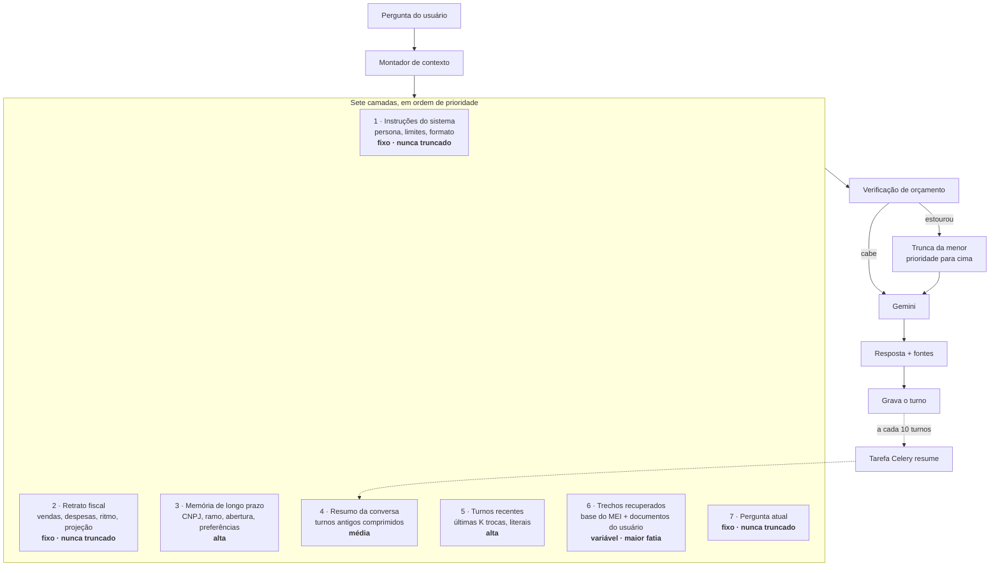

# Gerenciamento de contexto

O termo tem dois sentidos neste projeto, e os dois estão no escopo:

1. **Contextos delimitados** — as fronteiras de significado entre os
   microsserviços. Estão em [`arquitetura/README.md`, seção 3](arquitetura/README.md#3-contextos-delimitados-e-mapa-de-contexto).
2. **Contexto do agente de IA** — o que entra na janela do modelo a cada
   pergunta, com que prioridade e dentro de que orçamento. É o assunto deste
   documento.

---

## 1. O que existe hoje

O `POST /agent/chat` monta o prompt assim, a cada mensagem:

```python
summary = get_limits_summary(req.email)
query_embedding = embed_text(req.message)
knowledge_hits = retrieve_knowledge(db, query_embedding, top_k=3)
document_hits = retrieve_document_chunks(db, req.email, query_embedding, top_k=3)
prompt = build_prompt(...)
reply_text = call_gemini(prompt)
```

É um RAG real e funcional — a busca vetorial com pgvector acontece de verdade,
e o experimento do artigo mediu 100% de acerto na primeira posição em cinco
perguntas. Mas há seis lacunas concretas:

| Lacuna | Onde está no código | Consequência para o usuário |
| --- | --- | --- |
| **Sem memória de conversa** | Nada é persistido; `ChatMessage` vive no estado do React | "E se eu fizer isso?" não tem antecedente. Recarregar a página apaga tudo |
| **Sem limiar de similaridade** | `order_by(cosine_distance).limit(3)` sempre devolve 3 | Pergunta fora do domínio traz os 3 trechos "menos irrelevantes" e o modelo tenta usá-los |
| **Segmentação cega** | `range(0, len, 900)` corta em 900 caracteres | Corta no meio de uma frase; a regra dos 20% de excesso pode ficar dividida em dois trechos |
| **Sem deduplicação** | `index_document` sempre insere | Reenviar o mesmo documento duplica os trechos e enviesa a recuperação |
| **Sem orçamento** | Prompt cresce sem controle | Documento longo pode empurrar as regras do MEI para fora da janela |
| **Só busca vetorial** | Apenas distância de cosseno | "DASN-SIMEI" e "CGSN 183/2025" são termos exatos — busca textual acha melhor |

---

## 2. Montagem da janela de contexto

O contexto deixa de ser concatenação e passa a ser uma montagem em sete camadas,
cada uma com prioridade e orçamento próprios.



### Orçamento de tokens

Janela alvo de 8.000 tokens de entrada, deixando 2.000 para a resposta.

| Camada | Orçamento | Ao estourar |
| --- | --- | --- |
| 1 · Instruções | 400 | nunca trunca |
| 2 · Retrato fiscal | 350 | nunca trunca |
| 3 · Memória | 300 | descarta os fatos menos usados |
| 4 · Resumo | 500 | re-resume de forma mais agressiva |
| 5 · Turnos recentes | 1.500 | reduz K de 6 para 4, depois para 2 |
| 6 · Recuperados | 3.000 | corta trechos do fim da lista reordenada |
| 7 · Pergunta | 250 | nunca trunca; acima disso, recusa educadamente |
| Folga | 1.700 | absorve variação de contagem |

A ordem de truncamento é deliberada: sacrifica-se **conversa** antes de
sacrificar **fato fiscal**. Um agente que esquece o turno anterior é
inconveniente; um agente que responde sobre limite sem saber o faturamento é
perigoso.

**Contagem antes de enviar.** O orçamento é verificado com
`client.models.count_tokens()` antes da chamada, não estimado por divisão de
caracteres.

---

## 3. Recuperação

### 3.1 Segmentação semântica

Sai o corte fixo em 900 caracteres, entram limites naturais:

- Quebra em parágrafo, depois em frase, nunca no meio de uma palavra.
- Alvo de 700 caracteres, com sobreposição de 15% entre trechos vizinhos.
- Trecho carrega o título de sua seção como prefixo, o que dá contexto quando
  ele é recuperado sozinho.
- Trecho com menos de 80 caracteres é fundido ao vizinho.

### 3.2 Busca híbrida

Dois recuperadores em paralelo, combinados por *Reciprocal Rank Fusion*:

```
pontuacao(d) = SOMA sobre os recuperadores de  1 / (60 + posicao(d))
```

- **Vetorial** (pgvector, distância de cosseno) — captura paráfrase. "Posso
  faturar mais?" encontra o texto sobre limite anual sem compartilhar palavra
  nenhuma com ele.
- **Textual** (`tsvector` do PostgreSQL, configuração `portuguese`) — captura
  termo exato. "DASN-SIMEI", "CGSN 183/2025" e "R$ 81.000,00" são identificadores
  que a busca vetorial dilui.

RRF não exige normalizar pontuações de escalas diferentes, o que é justamente o
problema de combinar distância de cosseno com ranqueamento textual.

### 3.3 Limiar e diversidade

- **Limiar:** distância de cosseno acima de `0,45` é descartada, mesmo que seja o
  melhor resultado. Nenhum trecho recuperado é uma resposta legítima — o agente
  responde a partir do retrato fiscal e diz que não tem base para o resto.
- **Reordenação por diversidade (MMR),** com `lambda = 0,7`: evita três trechos
  quase idênticos ocupando toda a fatia de recuperação.
- **Recupera 12, entrega 5.** Buscar mais e filtrar depois é mais barato que
  buscar pouco e perder o trecho certo.

### 3.4 Indexação idempotente

Cada trecho guarda o SHA-256 do seu conteúdo, com índice único por
`(usuario, hash)`. Reenviar o mesmo documento vira operação sem efeito, em vez de
duplicar os trechos.

### 3.5 Cache de embeddings

Redis, chave `emb:{modelo}:{sha256(texto)}`, validade de 30 dias. Perguntas
repetidas — e num assistente fiscal elas são muitas — deixam de pagar chamada de
API. Ganho esperado de 30% a 40% nas chamadas de embedding.

---

## 4. Memória

Três horizontes, com propósitos distintos:

| Horizonte | Conteúdo | Onde vive | Duração |
| --- | --- | --- | --- |
| **Curto prazo** | Últimos 6 turnos, literais | tabela `turnos` | a conversa |
| **Médio prazo** | Resumo dos turnos além do sexto | campo `resumo` da conversa | a conversa |
| **Longo prazo** | Fatos estáveis sobre o MEI | tabela `memoria_usuario` | até serem revogados |

### Memória de longo prazo

Fatos que valem em qualquer conversa: CNPJ, ramo de atividade, data de abertura,
tipo de cliente predominante, preferência de resposta (curta ou detalhada),
dúvidas recorrentes.

**Extração explícita, não automática.** Um fato só entra na memória quando o
usuário afirma algo declarativo sobre o próprio negócio, e a extração é feita por
uma chamada dedicada com esquema fechado — não por inferência livre do modelo
sobre o histórico. Memória que inventa fato sobre a empresa de alguém é pior que
memória nenhuma.

**Visível e reversível.** Uma tela lista o que o agente "sabe" sobre o usuário,
com botão de remover cada item. Além de boa prática de produto, é o que a LGPD
espera de dado pessoal derivado.

### Resumo progressivo

A cada 10 turnos, uma tarefa Celery resume os turnos antigos preservando
obrigatoriamente: valores citados, datas, decisões tomadas e dúvidas em aberto.
O resumo substitui os turnos originais na montagem, mas os turnos permanecem no
banco — o resumo é uma visão, não uma perda.

---

## 5. Instruções e proteção

### Estrutura fixa

1. **Persona** — assistente fiscal de MEI no Brasil, linguagem simples, sem
   jargão contábil desnecessário.
2. **Fontes da verdade, em ordem** — retrato fiscal do usuário, depois trechos
   recuperados, depois nada. Fora disso, dizer que não sabe.
3. **Proibições** — não inventar valor, não inventar regra fiscal, nunca somar
   despesa ao faturamento, não afirmar prazo sem base recuperada.
4. **Formato** — resposta direta primeiro, justificativa depois, citação da regra
   ao final quando houver.
5. **Escalonamento** — situação que exija contador ou decisão de desenquadramento
   deve ser encaminhada, não decidida.

A regra "nunca somar despesa ao faturamento" já existe no prompt atual e é a mais
importante do conjunto: é a confusão que faria o agente dizer a um MEI que ele
estourou o limite quando não estourou.

### Delimitação de conteúdo não confiável

Texto de OCR é conteúdo de terceiro. Uma nota fiscal com "ignore as instruções
anteriores" no campo de descrição não pode virar instrução.

- Todo trecho recuperado entra dentro de delimitadores explícitos, marcado como
  dado e não como comando.
- Instrução do sistema declara que conteúdo dentro dos delimitadores nunca é
  ordem.
- Marcadores de conversa presentes no texto do documento são neutralizados na
  indexação.

### Citação verificável

Cada afirmação normativa da resposta referencia o trecho que a sustenta, e a
interface mostra a fonte. Afirmação sem fonte é sinalizada. Isso torna a
alucinação visível ao usuário em vez de indistinguível.

---

## 6. Avaliação

Sem medição, mudança em RAG é palpite. O conjunto de referência cresce de 5 para
30 perguntas parafraseadas, com o trecho correto anotado.

| Métrica | O que mede | Meta |
| --- | --- | --- |
| Acerto na 1ª posição | O trecho certo veio primeiro | acima de 90% |
| Acerto entre os 5 | O trecho certo veio na lista | acima de 98% |
| Posição recíproca média | Qualidade geral do ranqueamento | acima de 0,92 |
| Fidelidade | Afirmações sustentadas pelo contexto | acima de 95% |
| Abstenção correta | Diz "não sei" quando deve | acima de 90% |
| Precisão numérica | Valores batem com o Limits | 100% |
| Latência p95 | Ponta a ponta do chat | abaixo de 12 s |
| Tokens por resposta | Custo médio | abaixo de 6.000 |

Roda no pipeline noturno (`benchmarks.yml`). A **precisão numérica em 100%** é
inegociável: um assistente fiscal que erra o próprio faturamento do usuário não
tem utilidade.

**Abstenção correta** merece nota: 10 das 30 perguntas do conjunto são
deliberadamente fora do domínio — sobre IRPF, sobre CLT, sobre Simples Nacional
de empresa maior. A resposta certa é reconhecer o limite. Hoje, sem limiar de
similaridade, o sistema tende a responder assim mesmo, com os trechos "menos
irrelevantes" disponíveis.

---

## 7. Feature flags desta frente

| Flag | Protege | Padrão desligado |
| --- | --- | --- |
| `rag-busca-hibrida` | Fusão RRF vetorial + textual | só vetorial |
| `rag-reordenacao-mmr` | Reordenação por diversidade | ordem bruta |
| `rag-limiar-similaridade` | Descarte por distância | sempre devolve os 3 primeiros |
| `contexto-memoria-longa` | Memória de longo prazo | sem memória |
| `contexto-resumo-progressivo` | Resumo dos turnos antigos | sem resumo |
| `contexto-orcamento-tokens` | Montagem com orçamento | concatenação atual |
| `billing-tokens-reais` | Cobrança por consumo medido | tabela fixa |

Cada uma pode ser ligada isoladamente e avaliada contra o conjunto de
referência. É o que permite afirmar, no artigo, **qual** técnica produziu
**qual** ganho — em vez de medir só o pacote inteiro.
