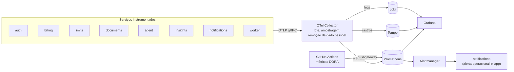

# Observabilidade

> Decisão: [ADR-0007](../adr/0007-observabilidade-otel-grafana.md).
> SLOs formais: [`slos.yaml`](slos.yaml).

Observabilidade aqui não é "colocar Grafana". É conseguir responder perguntas
que hoje não têm resposta:

- Por que **este** chat demorou 20 segundos?
- Quantos documentos caíram no caminho de contingência por regex esta semana, e
  por quê?
- Quanto custou, em reais, atender este usuário no mês?
- A projeção do dashboard está atrasada em relação ao Limits?
- Quantos MEIs estão hoje na faixa de risco de estouro?

---

## 1. Topologia



O **Collector no meio** é o que dá liberdade: os serviços falam OTLP e não
sabem quem consome. Ele também é o ponto único onde dado pessoal é removido
antes de sair da aplicação — e-mail vira hash, CNPJ é mascarado, texto de OCR
nunca vira atributo de rastro.

---

## 2. Métricas

### 2.1 RED — a saúde de cada serviço

Emitidas automaticamente pela instrumentação do FastAPI:

| Métrica | Tipo | Rótulos |
| --- | --- | --- |
| `http_server_requests_total` | contador | `service`, `method`, `route`, `status` |
| `http_server_duration_seconds` | histograma | `service`, `method`, `route` |
| `http_server_active_requests` | medidor | `service` |

**Rótulo `route` é o padrão da rota, nunca o caminho concreto.**
`/summary/{email}` e não `/summary/joao@exemplo.com` — caso contrário cada
usuário vira uma série temporal nova e o Prometheus explode em cardinalidade.
Como bônus, evita que e-mail vaze para dentro da métrica.

### 2.2 Recursos

| Métrica | O que revela |
| --- | --- |
| `db_pool_conexoes_em_uso` | pool esgotando antes de o erro aparecer |
| `db_query_duracao_segundos` | consulta lenta, por operação |
| `celery_fila_profundidade` | trabalho acumulando |
| `celery_fila_idade_mais_antiga_segundos` | há quanto tempo o mais antigo espera |
| `celery_tarefa_duracao_segundos` | por nome de tarefa |
| `celery_tarefas_total` | por tarefa e resultado |
| `redis_stream_lag` | consumidor ficando para trás |
| `outbox_pendentes` | publicador travado |
| `minio_operacoes_total` | armazenamento por operação |

### 2.3 Negócio — o que nenhuma ferramenta genérica dá

Estas são as que transformam o painel em evidência para o artigo:

| Métrica | Rótulos | Para que serve |
| --- | --- | --- |
| `documentos_processados_total` | `metodo`, `formato`, `resultado` | Quanto do fluxo usa Gemini contra regex |
| `extracao_confianca` (histograma) | `metodo` | Distribuição da qualidade, não só a média |
| `extracao_campos_corrigidos_total` | `campo` | Qual campo o humano mais corrige — aponta onde melhorar o prompt |
| `llm_tokens_total` | `modelo`, `operacao`, `direcao` | Consumo real ([ADR-0012](../adr/0012-medicao-real-de-tokens-do-llm.md)) |
| `llm_custo_estimado_reais_total` | `modelo`, `operacao` | Custo, em reais |
| `llm_chamadas_total` | `modelo`, `operacao`, `resultado` | Taxa de erro do fornecedor |
| `rag_similaridade_melhor` (histograma) | `tipo_base` | Qualidade da recuperação em produção |
| `rag_trechos_descartados_total` | `motivo` | Quanto o limiar está filtrando |
| `mei_uso_limite_razao` (histograma) | `faixa` | Distribuição dos usuários por faixa de risco |
| `alertas_disparados_total` | `codigo`, `nivel` | Quais alertas realmente acontecem |
| `alertas_dispensados_total` | `codigo` | Quais são ignorados — candidatos a remoção |
| `transacoes_criadas_total` | `origem`, `tipo` | Manual contra documento, venda contra compra |

O par `alertas_disparados_total` e `alertas_dispensados_total` é o instrumento
de calibração do motor de ritmo: um alerta com alta taxa de dispensa está
disparando cedo demais ou não é acionável.

---

## 3. Rastros

**Amostragem:** 100% em desenvolvimento; em carga, 100% dos erros e 10% do
resto, com amostragem baseada na cauda para preservar os rastros lentos.

**Spans manuais** nos pontos que a instrumentação automática não conhece:

```python
with tracer.start_as_current_span("extracao.gemini") as span:
    span.set_attribute("documento.formato", ext)
    span.set_attribute("documento.tamanho_bytes", len(conteudo))
    span.set_attribute("llm.modelo", GEMINI_MODEL)
    resultado = gemini_extract_from_image_bytes(conteudo, mime)
    span.set_attribute("llm.tokens_entrada", uso.prompt_token_count)
    span.set_attribute("llm.tokens_saida", uso.candidates_token_count)
    span.set_attribute("extracao.confianca", resultado["confidence"])
```

Pontos instrumentados manualmente: `ocr.tesseract`, `extracao.gemini`,
`rag.embedding`, `rag.busca_vetorial`, `rag.busca_textual`, `rag.reordenacao`,
`contexto.montagem`, `llm.geracao`, `insights.recalculo`, `alerta.avaliacao`.

**Continuidade através da fila.** O contexto de rastro viaja no cabeçalho da
tarefa Celery e no envelope do evento. Sem isso, o rastro morre no
enfileiramento e o fluxo assíncrono do [ADR-0003](../adr/0003-processamento-assincrono-redis-celery.md)
vira caixa-preta. **Entra na Onda 3**, junto com o próprio processamento
assíncrono — antes de a fila existir não há contexto a propagar. Até lá, a
US-12 cobre a propagação HTTP: `traceparent` (W3C Trace Context) injetado pelo
`httpx` instrumentado atravessa gateway → documents → limits sem código nosso.

**Atributos proibidos em span:** e-mail, CNPJ, texto de OCR, conteúdo de
mensagem do chat, nome de arquivo original.

---

## 4. Logs

JSON estruturado, uma linha por evento, saindo pelo stdout:

```json
{
  "ts": "2026-08-22T13:04:11.238Z",
  "nivel": "INFO",
  "servico": "documents",
  "evento": "documento.extraido",
  "trace_id": "4bf92f3577b34da6a3ce929d0e0e4736",
  "span_id": "00f067aa0ba902b7",
  "documento_id": "8f14e45f",
  "usuario_hash": "a3b1c9",
  "metodo": "gemini",
  "confianca": 0.95,
  "duracao_ms": 3310
}
```

**Primeira mudança a fazer:** o `auth` roda `create_engine(DATABASE_URL,
echo=True)`, despejando todo SQL executado no stdout — inclusive as consultas de
autenticação. Isso sai já na Onda 0.

| Nível | Quando usar |
| --- | --- |
| `ERROR` | Requer ação humana. Se ninguém precisa agir, não é erro |
| `WARNING` | Degradação com contorno: caiu para regex, retentativa, flag indisponível |
| `INFO` | Marco de negócio: documento confirmado, alerta disparado |
| `DEBUG` | Só em desenvolvimento |

**Nunca logar:** senha, chave de API, texto integral de OCR, conteúdo de chat,
CNPJ sem máscara, e-mail sem hash.

---

## 5. Painéis

Todos versionados como JSON em `infra/observability/grafana/dashboards/` e
provisionados automaticamente — painel construído a mão na interface se perde.

| Painel | Público | Responde |
| --- | --- | --- |
| **Visão geral** | qualquer um | Está tudo de pé? |
| **RED por serviço** | dev | Qual serviço está degradado e em qual rota? |
| **Pipeline de documentos** | dev | Onde os uploads estão parando? |
| **Agente e RAG** | dev | Qualidade da recuperação e latência do chat |
| **Custo de LLM** | produto | Quanto se gasta, por operação e por usuário |
| **Negócio MEI** | produto | Distribuição por faixa de limite, alertas, adoção |
| **SLO e orçamento de erro** | todos | Quanto orçamento resta em cada objetivo |
| **DORA** | processo | As quatro métricas de engenharia |

---

## 6. Alertas

Só dispara alerta o que exige ação humana. O resto é painel.

**As regras de queima de orçamento são geradas** a partir de
[`slos.yaml`](slos.yaml) por
[`tools/observabilidade/gerar_alertas.py`](../../tools/observabilidade/gerar_alertas.py)
e versionadas em
[`app/services/prometheus/rules/`](../../app/services/prometheus/rules/). A CI
(`observabilidade.yml`) reprova se o `.yml` sair de sincronia com o `slos.yaml`,
valida a sintaxe com `promtool check` e prova o comportamento com `promtool test`.

| Alerta | Condição | Severidade | Estado |
| --- | --- | --- | --- |
| `SLOQueimaDeOrcamento` | queima em 2 janelas (rápida 14,4× / média 6×) | página | ✅ US-13 |
| `SLOQueimaDeOrcamento` | queima lenta (1×, 3d/6h) | ticket | ✅ US-13 |
| `FilaAcumulando` | mensagem mais antiga acima de 5 min por 10 min | página | Onda 3 |
| `OutboxTravado` | pendentes acima de 100 por 5 min | página | Onda 3 |
| `ConciliacaoDivergente` | Insights diverge do Limits | página | Onda 3 |
| `AcuraciaExtracaoCaiu` | abaixo de 90% no pipeline noturno | ticket | Onda 3 |
| `FallbackRegexAlto` | acima de 20% das extrações por 1h | ticket | Onda 3 |
| `CustoLLMAcimaDoOrcamento` | acima de R$ 5,00/dia | ticket | Onda 3 |
| `FlagVencida` | flag além da data de remoção | ticket | ✅ higiene-flags.yml |

O alerta único `SLOQueimaDeOrcamento` carrega os rótulos `slo`, `janela` e
`severity` — o Alertmanager agrupa e inibe por eles (queima rápida inibe a
média do mesmo SLO). Roteamento em
[`app/services/alertmanager/alertmanager.yml`](../../app/services/alertmanager/alertmanager.yml).

Todo alerta de severidade "página" tem runbook em [`runbooks/`](runbooks/).
Alerta sem runbook é alerta que ninguém sabe atender.

---

## 7. Ordem de implantação

Instrumentar tudo de uma vez é o erro clássico — resulta em muita telemetria e
nenhuma pergunta respondida. A ordem abaixo entrega valor a cada passo:

1. **Logs estruturados + correlation-id no gateway.** ✅ US-09. Já permite seguir
   uma requisição pelos serviços com `docker compose logs`. Sem infraestrutura nova.
2. **Prometheus + Grafana + RED.** ✅ US-10.
3. **Métricas de negócio.** ✅ US-11. É onde a observabilidade deixa de ser genérica.
4. **Tempo + rastros.** ✅ US-12 (HTTP). A propagação pela fila fica para a Onda 3.
5. **Loki + correlação.** ✅ US-12. Salto de painel → rastro → log dentro do Grafana.
6. **SLOs + Alertmanager.** ✅ US-13. Regras geradas do `slos.yaml`, queima em
   múltiplas janelas, roteamento e inibição no Alertmanager.
7. **k6 + DORA.** US-14 / ✅ US-08 (DORA). Fecha o ciclo de medição.

A pilha (Collector, Tempo, Loki, Promtail, Grafana, Alertmanager) fica isolada
em `app/docker-compose.observability.yml` e não sobe no Compose padrão nem na CI:

```bash
docker compose -f docker-compose.yml -f docker-compose.observability.yml up -d --build
# Grafana:       http://localhost:3001  (datasources e dashboards provisionados)
# Alertmanager:  http://localhost:9093
```

O Prometheus (que sobe no Compose padrão) já carrega as regras de SLO de
`rules/` e as avalia; sem o overlay, os alertas ficam visíveis em
`http://localhost:9090/alerts` mas sem roteamento de notificação.
